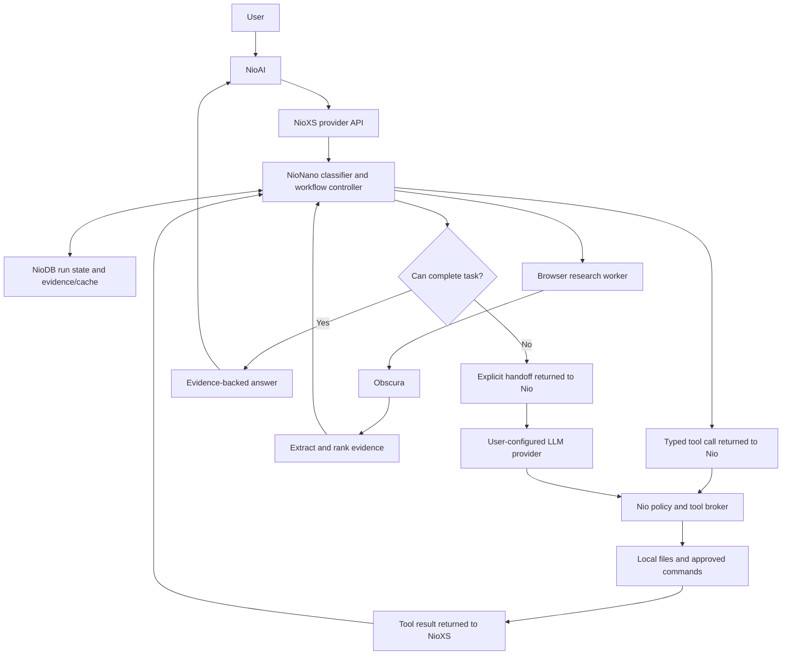

# NioXS and NioNano roadmap

Status: Phase 2 core implemented and tested; optional Crawl4AI probe deferred. Prepared 2026-10-09. Architecture and detailed flows: [NIOXS_PLAN.md](NIOXS_PLAN.md).

## Product identity and scope

**NioXS — the axis of Nio's non-LLM models.**

**AXIS = AI + XS**: NioAI carries AI and NioXS carries XS. XS does not designate a model size; Nano through Ultra are model tiers.

- Product: NioAI, executable `nio`.
- Required provider: NioXS, provider ID `nioxs`.
- First model: NioNano, model ID `nio-nano`.
- Future family: NioMini, NioCore, NioMax, NioUltra; names reserved in the design, with capabilities and resource tiers to be defined after Nano evaluation.
- Selection: `nioxs::nio-nano`.
- Default behavior: NioNano first, automatic continuation on an explicitly configured LLM when necessary.
- Browser: Obscura only; no Chromium.
- Search: browser-based, without search API keys; skip CAPTCHAs and blocked pages.
- Distribution: private implementation, downloadable binaries and artifacts on R2 or S3.
- Persistence: NioDB core HTTP records API for workflow state, research cache, and optional feedback.
- NioJS: excluded from v0.1.0.

NioNano first means build one useful model and its minimum provider surface before expanding into a model platform. No Mini/Core/Max/Ultra implementation until Nano is evaluated and released.

NioXS is mandatory even for a local installation: `nio` connects to a loopback NioXS API, which runs NioNano. Hosted NioXS is a second deployment of the same contract. A local-first pilot is the proposed implementation order, not a requirement that every future user self-host.

## Architecture



NioXS also connects to NioDB for durable run/action records, scoped evidence/cache, and opt-in feedback. Nio retains its own sessions and all client command approvals. Database persistence never grants command permissions.

Browser research can run in the provider deployment when the request permits web access. For deployments that require browser execution on the client, use a Nio client tool instead. Project files and commands always stay under the client broker in the initial design. Provider-side tools and client-side tools need distinct ownership to avoid duplicated execution.

## Repository and implementation choices

Proposed private repository `nio-xs` contains the provider service, Nano runtime, browser worker, artifact manager, and training/evaluation utilities. Use Rust for the provider and runtime, Python for offline training. Crawl4AI remains an optional Python extraction component if it works with Obscura without installing Chromium. Add a Rust NioDB HTTP storage adapter; use records directly and avoid its Nio/LLM assistance and SQL fallback. NioDB is required for persisted workflows, and NioJS is not part of the stack.

The existing public `nio` repository contains only provider integration, handoff handling, client tool enforcement, and user-facing configuration. Private model code and weights are not committed here. Documentation in this workspace describes the design; it is not a secret implementation.

Suggested private structure, not created yet:

```text
nio-xs/
  crates/
    provider/       HTTP API, catalogs, sessions, protocol adapters
    nano/           features, model inference, workflows, completion checks
    browser/        Obscura integration and search adapters
    artifacts/      signed manifest and install/update logic
    storage/        NioDB HTTP adapter, record schemas, retention, recovery
  training/         datasets, training, calibration, export
  evaluation/       fixtures, task corpus, live browser smoke tests
  contracts/        request, action, result, capability, handoff schemas
```

## v0.1.0: five implementation phases

The detailed task checklist is [TODO_V0.1.0.md](TODO_V0.1.0.md). All tasks are initially open. The architecture document defines the design; this roadmap defines release order and the checklist tracks implementation. No calendar estimates are committed before feasibility is measured.

| Phase | Objective | NioXS deliverables | NioNano deliverables | Exit gate |
| --- | --- | --- | --- | --- |
| Phase 1 | Foundations and provider connection | Private structure, provider/storage contracts, NioDB connectivity, minimal API, Nio provider registration | Capability definitions, evaluation corpus, durable run/action schema | Nio selects nioxs::nio-nano, completes one client tool round trip, and handles cancellation; Obscura-only feasibility is demonstrated |
| Phase 2 | First trained model and project workflows | Artifact loading, capability metadata, NioDB-backed workflow continuation and recovery | Python-trained classifier, Rust inference, argument validation, project inspection, file/code search, approved checks | Held-out supported and unsupported requests are evaluated; project workflows execute through Nio's broker without extra permissions |
| Phase 3 | Adaptive browser research | Obscura worker, search adapters, NioDB-backed scoped cache and evidence records | Search-to-website flow, extraction, ranking, package comparison, complexity-based expansion | Small lookups stop early; broader requests expand; CAPTCHA and timeout handling remain bounded; no Chromium is installed |
| Phase 4 | Handoff and interoperability | Automatic LLM continuation in Nio, streaming conformance, basic local MCP server/client support | Completion checks, persisted handoff records, opt-in feedback, mapped MCP workflows | Handoff preserves completed actions and permissions; one external API client and local MCP integrations pass end-to-end checks |
| Phase 5 | Packaging and v0.1.0 release | Signed artifacts, R2/S3 install/update, NioDB deployment/backup/recovery, default rollout | Evaluated and pinned trained model, measured footprint, published capability limits | Clean-machine acceptance passes and release blockers are closed before fresh-install default activation |

Dependencies: Phase 1 → Phase 2 → Phase 3 → Phase 4 → Phase 5. Establish browser feasibility in Phase 1 so an incompatible engine does not become a late surprise. Define the handoff schema in Phase 1, implement it in Phase 4.

## v0.1.0 release scope

Include one trained non-LLM model, the required NioXS provider, supported project workflows, keyless adaptive browser research, automatic configured-LLM fallback, the documented text Chat Completions subset, basic local MCP, NioDB-backed persistence, and verified self-hosted distribution. NioDB assistance, SQL fallback, vectors/embeddings, and NioJS integration are outside this release.

Start platform validation with Linux x86_64. Add macOS ARM64 to v0.1.0 only if its full release checks pass; record the actual supported platform matrix. Hosted service operation is a separate rollout: v0.1.0 documents deployment and authentication but does not require launching a public hosted service.

The user requested Nano as the development default during Phase 1. The Nio development build now uses nioxs::nio-nano when no model is selected. Existing explicit model selections remain unchanged unless intentionally changed; Kilo remains a built-in alternative. Production release gates still apply.

Defer Mini/Core/Max/Ultra models, remote MCP transport, broader Responses API compatibility, multimodal generation, arbitrary autonomous repairs, additional platform expansion, and a public hosted launch until after v0.1.0.

## Initial task workflows

1. **Inspect project:** identify files and manifests, detect project type, extract available commands, report direct evidence.
2. **Find code:** extract search terms and optional file filters, search, rank matches, return exact snippets and paths.
3. **Run checks:** detect an explicitly supported configured command, request existing approval, run it, parse output, report failures. Never accept arbitrary generated shell strings as a workflow shortcut.
4. **Research sources:** form bounded queries, read search results, choose URLs, visit small batches, return source-linked passages.
5. **Compare packages:** fill named comparison fields from accessible metadata/documentation, preserve missing fields and conflicts.

Large novel features, original prose, creative design, and unfamiliar code fixes are outside the first local capability set. They can hand off immediately. Rules and trained classification select workflows; tools implement the actual actions.

## Adaptive research policy

| Request | Initial successful-page target | Maximum successful pages | Maximum destination attempts |
| --- | ---: | ---: | ---: |
| Lookup | 1 | 2 | 5 |
| Evidence for explanation/debugging | 2 | 5 | 10 |
| Comparison | 3 | 8 | 16 |
| Broad research | 4 | 12 | 24 |

Begin with two concurrent destination reads and at most three search-engine attempts. Apply separate deadlines and byte limits from the design document. These numbers are tunable starting points, not required page counts.

Complexity is estimated from task intent, requested entities, requested fields, breadth, and recency. Coverage determines expansion. If an official page supplies all required fields, stop. If content is repetitive or no useful candidates remain, stop. If sources conflict, gather additional evidence within budget or report the conflict.

CAPTCHA on a results page means try another engine. CAPTCHA on a destination means skip that URL. Never count challenge content as successful evidence. If no sources are accessible, return the access limitation; a model switch does not guarantee better browser access.

## Provider and handoff contract

The compatibility API starts with `/v1/models` and text `/v1/chat/completions`, including streaming and standard tool-call/result handling. Keep progress and handoff details in a documented NioXS extension instead of inventing OpenAI finish reasons or masquerading a handoff as an executable tool.

Phase 1 must choose the exact extension schema and stream behavior. Required invariants:

- Clients can determine requested model, actual execution path, turn ID, and whether continuation is needed.
- A standard API client can receive a supported answer or a clear capability limitation without understanding Nio-specific handoff.
- Nio understands the handoff extension and automatically continues only when its policy permits.
- Partial progress is never marked as a completed answer before handoff settles.
- Stateful workflow continuation is correlated and isolated, with bounded state lifetime; replayed requests cannot rerun previously applied edits or commands.
- Provider-side browser execution respects `--no-tools` and caller permissions, even though it does not call Nio's local tool dispatcher.
- NioXS does not receive user LLM-provider credentials for the initial fallback design.

A follow-up to an already delegated coding task should retain task context and delegate again directly when necessary. Starting new turns with Nano must not restart the original work.

## MCP rollout

First exported tools: research and webpage extraction. First consumed tools: explicitly configured, schema-mapped capabilities. Tool discovery does not make arbitrary tools understandable to Nano.

Basic local stdio server/client support is in Phase 4 for v0.1.0; remote Streamable HTTP follows after v0.1.0 with deployment policy and negotiated protocol support. API and MCP reuse the same execution and permission logic. A hosted MCP endpoint can access only its authorized workspace, not arbitrary caller files.

## Distribution flow

```text
Private source + training data
    → Evaluate and build pinned versions
    → Produce signed manifest + platform artifacts
    → Publish immutable version paths on R2/S3
    → Download and verify on deployment host
    → Start NioXS API with Nano and Obscura
    → Configure Nio's nioxs provider endpoint
```

Hosted mode: users configure the NioXS endpoint; the operator manages artifacts. Self-hosted mode: users download artifacts and run NioXS locally. Closed source does not imply offline execution when the configured endpoint is remote.

Keep runtime, model artifacts, Obscura, and NioDB independently versioned, but require a tested compatible bundle. Document NioDB process startup, credentials, durable volume, schema compatibility, backup, recovery, and failure behavior. Include dependency notices and required Crawl4AI attribution if used. Public downloads can coexist with private source. Never distribute storage write credentials.

## Acceptance and measurement

Test NioDB reconnect, revision conflicts, bounded retention, expired cache, restart recovery, and unknown action outcomes. An outage must not cause action replay, an untracked persistence fallback, or database-assisted model execution.

Before Phase 1 ends, record the evaluation corpus and provisional quantitative thresholds. Adjust targets only with documented evidence; do not make up latency, memory, or accuracy guarantees now.

Track supported task completion, incorrect unsupported-task acceptance, abstention behavior, useful evidence coverage, fallback reasons, tool replay, blocked-page frequency, latency, peak memory, and artifact footprint. Report results by workflow rather than one flattering aggregate score.

Release-blocking checks: permissions hold, cancellations stop work, handoff is explicit, sources match extracted facts, incomplete results are labeled, budgets are bounded, model/artifact versions are identifiable, rollback works, and no Chromium installation occurs. Use fixtures for reproducible tests and live smoke tests for browser compatibility.

## Next concrete work

Start Phase 1 with three proofs:

1. Search results to useful destination excerpts using Obscura only, across simple lookups and comparisons, including blocked-page fixtures.
2. A documented NioXS request, client tool call, tool result, final response, and handoff example.
3. A labeled intent/evaluation dataset specification distinguishing supported tasks, missing inputs, and tasks requiring LLM fallback.

The first phase produces reviewable evidence and contracts. It does not require implementing the complete provider, training pipeline, MCP platform, or all future model tiers at once.

## Implementation checkpoint — 2026-10-09

Phase 1 core: Rust workspace, NioDB immutable-event adapter, provider contracts/service, built-in default Nio connection, and live Obscura feasibility checks. See [acceptance evidence](evaluation/PHASE1_EVIDENCE.md). Nano currently uses an exact read-README rule, not trained inference. Phase 2–5 remain open. The optional Crawl4AI CDP probe is deferred and Crawl4AI is excluded.

## Phase 2 checkpoint

Trained artifact, Rust/Python parity, typed project workflows, immutable command journal, and real Nio permission/recovery checks are implemented. See [Phase 2 evidence](evaluation/PHASE2_EVIDENCE.md). Phase 3 browser workflows, Phase 4 handoff/MCP, and Phase 5 production evaluation/distribution remain open.
