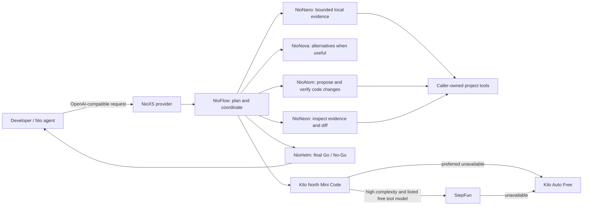

# NioXS plan and project status

**AXIS = AI + XS.** AXIS combines the compact MicroLM decision layer, Rust-controlled execution, and language-model reasoning in a bounded assistant for developer tools.

This is the single planning document for product direction, architecture, release phases, and open work. The user-facing directives remain in [README.md](../README.md); the API and storage contracts remain in [contracts/README.md](../contracts/README.md) and [contracts/storage.md](../contracts/storage.md); setup steps remain in [DEVELOPMENT.md](DEVELOPMENT.md); evaluation results remain in [Phase 1](../evaluation/PHASE1_EVIDENCE.md) and [Phase 2](../evaluation/PHASE2_EVIDENCE.md); release history remains in [CHANGELOG.md](../CHANGELOG.md).

**Current workspace version: v0.4.1** (from the workspace manifest). Change version and capability claims only when their acceptance evidence exists.

## Contents

1. [Product direction and roles](#1-product-direction-and-roles)
2. [Architecture and permissions](#2-architecture-and-permissions)
3. [Model family and NioFlow cascade](#3-model-family-and-nioflow-cascade)
4. [Five advancement priorities](#4-five-advancement-priorities)
5. [Project context and web research](#5-project-context-and-web-research)
6. [Local learning model and evaluation](#6-local-learning-model-and-evaluation)
7. [Provider, storage, and distribution](#7-provider-storage-and-distribution)
8. [Release phases](#8-release-phases)
9. [Open work](#9-open-work)
10. [Acceptance and measurement](#10-acceptance-and-measurement)
11. [Development and sources](#11-development-and-sources)

## 1. Product direction and roles

NioXS is the OpenAI-compatible provider and workflow layer. Nio remains in charge of the user interface, project trust, approvals, local tools, sessions, and cancellation. NioXS and its models propose typed actions; the caller's tool broker performs project reads, edits, and commands under its existing permission policy.

**AXIS = AI + XS** describes the product architecture. **MicroLM** is the local, compact learning and decision layer. Hosted or local generative language models provide language generation when a workflow needs it. Nio model names describe roles and behavior, not independently trained weights unless a model actually has its own trained artifact.

Use Rust for deterministic routing, tool contracts, project evidence, policy, safe patch validation, and outcome checks. Use Python for offline MicroLM training and evaluation. Any user task or project content used for model training requires explicit opt-in; runtime task records are not training consent.

## 2. Architecture and permissions

The caller owns host permissions. A tool is usable only when the caller advertises it for that turn. NioXS does not create extra file or command privileges, bypass Ask/Plan/Build policy, replay a mutation after an uncertain outcome, or treat a model's Go as permission to execute.

Project files, tool outputs, and web pages are untrusted data. They cannot change the tool allowlist. Keep action identifiers, arguments, and results correlated. On cancellation, stop pending orchestration and preserve the known results of earlier actions.

## 3. Model family and NioFlow cascade

| Model | Role | Responsibility |
| --- | --- | --- |
| `nio-nano` | Local MicroLM assistant | Classify supported bounded work, inspect supplied evidence, run native project workflows |
| `nio-flow` | Orchestrator | Read the request, prepare a short task plan, route and hand off each bounded stage |
| `nio-echo` | Answers | Direct questions and conversation without a specialist cascade |
| `nio-sage` | Teaching | Explain concepts using examples and relevant evidence |
| `nio-quill` | Writing | Draft and polish prose without applying project changes |
| `nio-scout` | Research | Investigate available sources with attribution and stated gaps |
| `nio-thinker` | Reflection | Rust-controlled draft, challenge, and refine phases; bounded read-only evidence; Helm only on explicit opt-in when Thinker is selected directly |
| `nio-nova` | Exploration | Generate and compare creative alternatives when the task benefits |
| `nio-atom` | Implementation | Prepare a safe patch, apply it through caller tools, run checks, and repair within limits |
| `nio-neon` | Review | Check requirements, changed files, risks, and actual verification results |
| `nio-helm` | Final decision | Give evidence-linked Go, Conditional Go, or No-Go after the other applicable stages |

**NioFlow starts with Kilo North Mini Code by default.** If the Kilo catalog does not offer it or the request fails before any output is relayed, use Kilo Auto Free. For a high-complexity plan, check the live Kilo `/models` catalog for a free, tool-capable StepFun model and use it when available. If it fails before a response, fall back to Auto Free. Respect explicitly configured upstream choices.

### NioFlow stage rules

1. Prepare a compact plan from the prompt, constraints, and available caller tools.
2. Ask NioNano for bounded reads, searches, symbol information, or diagnostic triage whenever useful. Nano may help any specialist; its evidence follows the task.
3. Use Echo for direct answers, Sage for teaching, Quill for writing, Scout for source research, and Thinker for bounded assumption checking when useful. Direct selection of these profiles does not invoke Helm. Route creative exploration to Nova only when alternatives or a prototype are useful.
4. Route code changes through Atom. Route completed changes and verification evidence through Neon.
5. Ask Helm for the final Go / No-Go after the applicable specialist stages by default. A user-selected `--no-helm` directive skips that gate for the current task and lets the final specialist answer. Helm is not the initial planner and cannot grant a missing permission.
6. Stop within fixed stage and tool budgets. If a stage fails, a tool is unavailable, checks fail, evidence is incomplete, or input is missing, pass the limitation forward and let Helm report No-Go or Needs Input.
7. Preserve the plan and bounded evidence across client handoffs. Reuse identical tool results. A repeated tool request must not execute the same mutation again.

The planner may propose only known stages. Rust validates stage names, order, per-stage limits, required tools, and criteria. If a generated plan is malformed, use a safe bounded route or ask for clarification; never run unvalidated plan text as a command.

### Go / No-Go evidence

Helm reports **Go** only when every stated requirement has evidence and every required check has a successful result after the latest change. Failed checks, missing permissions, unfinished repair, or missing evidence mean **No-Go**. Missing user decisions mean **Needs Input**. A Go result describes readiness against the listed criteria and does not replace caller approval or claim unrun tests passed.

## 4. Five advancement priorities

Implement in this order. Each item must have observable acceptance evidence before it is described as complete.

### 1. Reliable tools

- Reuse identical file, search, and check results already returned in the current task.
- Do not repeat a read unless its requested range or file version changed.
- Enforce an explicit per-task tool budget, announce exhaustion, and ask the current specialist to finish from existing evidence.
- Store action identifiers and outcomes so retries do not replay writes or commands.

**Done when:** repeated reads reuse evidence; repeated edits/commands are blocked; tool exhaustion ends with an accurate answer; cancellation preserves completed outcomes.

### 2. Real coding

- Let Atom produce bounded patch requests and route them to the caller's existing patch/write tools.
- Require fresh file content before patching and exact matching before applying changes.
- Run checks through caller-advertised tools and permissions. Feed failures and parsed compiler diagnostics back to Atom for a bounded repair.
- Review the resulting diff with Neon, then ask Helm for the final decision.

**Done when:** a real fix can be proposed/applied through the caller, validated by configured checks, reviewed, and reported with the observed result; unavailable edit or command tools never trigger local file or shell access.

### 3. Better context

- Use Rust to index file paths, symbols, references, manifests, and diagnostic locations.
- Reuse cached data only while its file version remains current; refresh after edits.
- Rank small, exact excerpts within a declared context budget. Preserve the path and line span for every excerpt.

**Done when:** representative tasks reach the relevant definition and callers with fewer duplicate reads, and every finding points to returned project evidence.

### 4. Smarter decisions

- Improve MicroLM/Helm from fixed prompt keywords toward decisions based on task state, allowed tools, evidence, failed checks, cost, and prior opt-in outcomes.
- Calibrate confidence and abstain when evaluation does not support a decision.
- Keep model choice separate from permission policy; measure quality before automatic escalation to a more costly model.

**Done when:** held-out tasks improve stage selection and abstention over the rules baseline without increasing unauthorized actions.

### 5. Measure improvement

- Compare AXIS with the same upstream model, prompt, tools, context, and limits without AXIS.
- Use independent, real repository tasks and hidden completion checks. Keep training examples separate from acceptance tasks.
- Report success, regressions, unsupported completion claims, tool calls, repeated reads, latency, tokens, and cost by workflow.

**Done when:** a reproducible report includes the task set, model and versions, harness settings, denominators, failures, and paired results. Existing authored synthetic classifier scores are not broad coding-agent evidence.

## 5. Project context and web research

Use bounded tools selected by task needs. File reads and search results must identify project-relative paths and line ranges. Symbol and diagnostic context should remain compact and refresh after a patch. For a code change, the active plan should name affected files and the check expected to verify each requirement.

The browser worker uses native Rust search/fetch and extraction workflows. Keep page counts, candidate attempts, bytes, concurrency, and deadlines bounded. Skip challenge/login pages without trying to defeat them. Return source URLs and distinguish partial coverage from verified facts. NioDB-backed cache/quota wiring and live research evidence remain open below.

## 6. Local learning model and evaluation

The checked-in Nano artifact is a 46,894-byte multinomial naive Bayes classifier with seven labels. Training runs offline in Python; inference and typed workflows run in Rust. Current specialist prompts share the same upstream model selection; these profiles do not each have separate learned weights. NioHelm's Rust route heuristic uses rules and hand-set weights; these weights are not calibrated probabilities.

Phase 2 reports Rust/Python probability parity within 1e-10 on 280 development fixtures. On the separate small authored frozen holdout, the raw classifier macro F1 is 0.9711 and the typed router macro F1 is 0.9943 with 0/100 unsupported requests accepted. The report explicitly limits those results to that corpus. Read [Phase 2 evidence](../evaluation/PHASE2_EVIDENCE.md) for the split, methods, and caveats.

Use family/project-separated data splits. Keep benchmark tasks frozen before tuning; test on fresh, independently authored repository tasks before claiming AXIS coding gains. Never silently retain prompts, source files, or upstream tool outputs for training.

## 7. Provider, storage, and distribution

The provider exposes the implemented API subset and the current model catalog. Read [provider contract](../contracts/README.md) for schemas, limits, handoff, and endpoints. Read [storage contract](../contracts/storage.md) for NioDB record schemas, idempotency limits, recovery behavior, and retention gates.

The provider journals typed workflow actions in NioDB. Durable intent is not proof that a caller executed a client-side action. Unknown command outcomes must be inspected before retry; do not claim exactly-once execution. Keep project evidence bounded and scoped; never store provider credentials in task records.

Model runner, model-weight downloads, plugins, and dataset packs require compatible manifests, integrity checks, resource limits, license review, and clear capability metadata. Do not advertise a model or capability as shipped when only a draft design or unintegrated module exists. Keep external model terms and the actual upstream model identity visible; profile names are not claims of model ownership.

## 8. Release phases

Phases are engineering gates; workspace tags are releases. A release may deliver multiple phases, and one phase may span releases.

| Phase | Goal | Current state |
| --- | --- | --- |
| 1. Foundations | Provider/contracts, persistence boundary, caller tool round trip | Complete with evidence |
| 2. Nano | Trained classifier, typed workflows, permission and recovery evidence | Complete with evidence |
| 3. Research | Native search/fetch workflows, scoped cache, quotas, live evidence | Engine exists; cache/quota and evidence gates remain |
| 4. Coding and interoperability | Safe writes, edit/check flow, handoff, API/MCP loops | Partial; shipped features and remaining gates are listed below |
| 5. Release quality | Independent evaluation, packaging, install/update, rollback | Open |

Version claims follow the workspace manifest and [CHANGELOG.md](../CHANGELOG.md). Release readiness additionally requires passing phase acceptance gates; a version tag alone is not evidence of product quality.

## 9. Open work

### Current five priorities

The ordered tasks in [§4](#4-five-advancement-priorities) are the main roadmap. Track their implementation here as each phase is authorized and accepted.

### Phase 3 remainder

- Wire bounded research evidence/cache to NioDB with scoped keys, expiry, quotas, clearing, and invalidation.
- Test workspace isolation, cache reuse/expiry, quota enforcement, write failures, and challenge-page exclusion.
- Record reproducible live research observations and limitations.

### Phase 4 remainder

- Implemented NioFlow planning, validated specialist stages, native Nano evidence, cached-read reuse, bounded tool-call correction, and a final tool-free Helm stage. Provider tests cover real separate upstream calls, carried-forward drafts, and caller-tool continuations.
- Persist handoff state beyond the current bounded in-memory cache; provider restarts currently stop continuation without replaying tools.
- Connect Nio's broker to a configured local MCP server; map known tools and abstain on unknown schemas.
- Validate external OpenAI-compatible tool loops, SSE behavior, cancellation, and history continuity.
- Store opt-in outcome feedback with retention/export; no automatic prompt uploads or retraining.
- Regenerate capability metadata from the actual shipped workflow and model catalog.

### Phase 5

- Evaluate on fresh task families and independent real repositories, with paired same-model AXIS/baseline reports.
- Measure task success, regressions, false completion, cost, latency, memory, startup, and installed size.
- Validate clean-machine installation, signed manifests, platform artifacts, NioDB backup/recovery, artifact compatibility, update, and rollback.
- Publish capability limits, known failures, dependency notices, and a reproducible release report.

### Deferred extension ideas

These are design notes, not shipped features:

- **Plugin runner:** strict JSON-over-stdio subprocesses with versioned `plugin.toml`, runtime, entry point, minimum NioXS version, SPDX license, SHA-256, declared tools, deny-by-default filesystem/network/exec grants, time/CPU/memory caps, journaled install/run/remove, no implicit install or upgrade.
- **Knowledge packs:** a separate public dataset repository with small inspectable packs, attribution/provenance, pinned content hashes, explicit licensing checks, and opt-in download/cache. The former dataset design has been pruned from the active implementation roadmap; revisit only with a concrete supported workflow.
- **Local inference:** not included in the current model catalog or runtime. The release uses the configured upstream providers; local model execution remains out of scope until explicitly adopted and fully acceptance-checked.
- **Additional model roles:** the current supported names and role skills are documented in the table above. Add new names only with distinct behavior and acceptance criteria.

## 10. Acceptance and measurement

For each workflow, measure:

- Completion against hidden or independently checked requirements.
- Regression rate and failed checks after edits.
- False Go verdicts and unsupported requests incorrectly accepted.
- Evidence coverage, repeated tool calls, and unnecessary file reads.
- Tool/model handoffs, latency percentiles, token use, and cost.

Compare paired runs on the same task, upstream model, project state, caller tools, and resource budget. Publish failures and denominators by task type. Report classifier benchmark scores separately from code-task results. Use SWE-bench-style tasks as one signal, and maintain fresh Nio-owned tasks to reduce benchmark familiarity; never imply a synthetic routing score proves parity with a large generative model.

Security and lifecycle gates: denied approvals never execute; paths stay in the caller's project; tool output is treated as data; side effects are not automatically replayed; expired state cannot authorize a new action; cancellation stops pending work; partial results are labeled; tool limits terminate cleanly.

## 11. Development and sources

Local setup, reproducible build commands, and offline model training instructions live in [DEVELOPMENT.md](DEVELOPMENT.md). API examples and schemas live in [contracts/examples](../contracts/examples). Phase reports are the evidence record; this plan describes goals and acceptance gates.

The upstream model selector checks Kilo's `/models` catalog, prefers `cohere/north-mini-code:free` when present, and falls back to `kilo-auto/free` if absent or unavailable before response output. Explicit model configuration remains respected.

Relevant external protocols and tools: [OpenAI-compatible Chat Completions](https://developers.openai.com/api/reference/resources/chat/subresources/completions/methods/create), [MCP architecture](https://modelcontextprotocol.io/docs/learn/architecture), [GitHub repository social preview settings](https://docs.github.com/en/repositories/managing-your-repositorys-settings-and-features/customizing-your-repository/customizing-your-repositorys-social-media-preview).

**Plan maintenance:** update this file after accepted code changes; leave contracts, test evidence, developer setup, and release history in their focused files. Do not reintroduce a second roadmap/checklist file.
## Appendix A. Decision and handoff contract

A decision endpoint can score candidate actions, but scoring is advisory until a caller policy actually authorizes execution. Every candidate should include typed arguments, required fields, permission state, evidence references, and cost. Outcomes are Go/execute, clarify, abstain/No-Go, or handoff. Keep a deterministic safety gate before learned ranking, an explicit abstention path, and a durable action journal around side effects.

A bounded handoff carries the original task reference, the validated subtask, specialist identity, relevant evidence references, allowed tool names, current budget, completed actions, check outcomes, and unresolved questions. Never hand off a denied action or cancellation as a way around policy. Re-read edited files before preparing later patches.

## Appendix B. Deferred plugin and data-pack design

A plugin process should communicate through a strict JSON-over-stdio contract. Start with a local manifest and process supervisor, then permissions, resource caps, and audit before any registry download. A plugin cannot access undeclared paths or hosts, ambient credentials, or shell. Pin hashes and licenses; require consent for installation and never auto-upgrade.

If domain packs are revisited, keep them as data rather than executable code. Record source, provenance, license, and hashes; verify both archive and content before install; bound cache size and expiry; permit offline reuse. A pack must not be used as training data unless its license and provenance allow it.

These designs do not change current runtime claims until implemented and evaluated.
