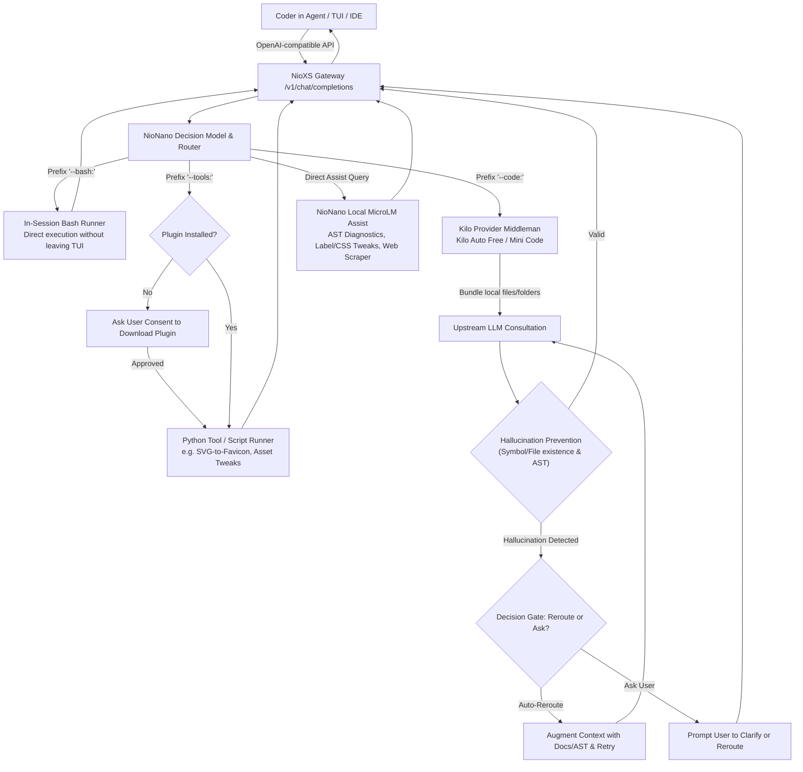

# NioXS and NioNano roadmap

Status: Re-architected as a **Pure Coding Assist Companion** (OpenAI-compatible drop-in for coding agents/TUIs) rather than an autonomous agent. Synced 2026-10-13. Architecture and detailed flows: [PLAN.md](PLAN.md).

## Release & phase map

One vocabulary. **Phase 1–5** are the structural roadmap stages; **`vX.Y.Z`** is the shipped release (the workspace `Cargo.toml` version and the git tag). They are not rival schemes: a phase is delivered by one or more releases, and a release may carry work from more than one phase. This table is authoritative — [TODO_V0.1.0.md](TODO_V0.1.0.md) and [NEXT.md](NEXT.md) describe the same state in these terms.

| Release | Phase | State |
| --- | --- | --- |
| `v0.2.0`–`v0.2.7` | Phase 1–2 baseline, plus features shipped ahead of their gates (coding engine, research engine, MCP server, release matrix) | Phase 1–2 complete with evidence; Phase 3–4 gates open |
| `v0.3.0`–`v0.3.3` | Phase 4 (safe writes, honest surface): `safe_path`-gated edits, honest `/v1/capabilities`, `--code` handoff, full 8-target release matrix | **Current release** |
| `v0.4` (planned) | Phase 4 remainder: MCP live client round-trip (the protocol surface now has acceptance tests in `crates/provider/src/mcp.rs`), learned decision weights, plugin supervisor | Planned |
| `v0.5` (planned) | Phase 3 remainder (research cache/quota) plus dataset index and packs | Planned |
| Phase 5 (ungated) | Packaging, distribution, production evaluation | Open |

Rule (unchanged): version strings and capability claims change only when their exit evidence exists.

## Product identity and scope: Pure Coding Assist Companion

**NioXS & NioNano — The Developer's In-TUI Coding Companion & Policy Arbiter.**

NioXS does not seek to be a blind, autonomous coding agent that silently edits codebases. Instead, NioXS is an **OpenAI-compatible assistant layer** that plugs directly into any coding agent or TUI (Aider, OpenCode, Cline, Continue, Roo Code, Cursor, Neovim) as a switchable model (`nio-nano`) or gateway. 

Along the project lifecycle, developers switch to NioNano for quick assistance (e.g. changing labels, font-colors, CSS tweaks, AST diagnostics, keyless web lookups) or leverage **explicit prefix triggers**:

- `--tools: <task>`: Runs pre-defined specialized tools and Python plugins (e.g., SVG-to-favicon generator, image resizers, asset pipelines). Prompts the user for confirmation before downloading any external plugins.
- `--bash: <cmd>`: Executes bash command lines directly in-session, eliminating the need to leave or exit the coding agent TUI.
- `--code: <prompt>`: Consults upstream LLMs (Kilo provider + Kilo auto free / mini code models). NioXS acts as an intelligent middleman by bundling relevant local files/folders, sending them to the LLM, and streaming the response back.
- **Decision Model Arbiter**: Determines safety gates, validates bash safety, prompts user approval before plugin downloads, and prunes context before sending to Kilo LLMs.

## Architecture



NioXS also connects to NioDB for durable run/action records, scoped evidence/cache, and opt-in feedback. Nio retains its own sessions and all client command approvals. Database persistence never grants command permissions.

Browser research can run in the provider deployment when the request permits web access. For deployments that require browser execution on the client, use a Nio client tool instead. Project files and commands always stay under the client broker in the initial design. Provider-side tools and client-side tools need distinct ownership to avoid duplicated execution.

## Repository and implementation choices

Proposed private repository `nio-xs` contains the provider service, Nano runtime, browser worker, artifact manager, and training/evaluation utilities. Use Rust for the provider and runtime, Python for offline training. Crawl4AI remains an optional Python extraction component if it works with Obscura without installing Chromium. Add a Rust NioDB HTTP storage adapter; use records directly and avoid its Nio/LLM assistance and SQL fallback. NioDB is required for persisted workflows, and NioJS is not part of the stack.

The existing public `nio` repository contains only provider integration, handoff handling, client tool enforcement, and user-facing configuration. Private model code and weights are not committed here. Documentation in this workspace describes the design; it is not a secret implementation.

Actual crate workspace (matches the structure proposed when this roadmap was written):

```text
nio-xs/
  crates/
    provider/       HTTP API, catalogs, sessions, protocol adapters
    nano/           features, model inference, workflows, completion checks
    browser/        search adapters and HTML extraction
    artifacts/      signed manifest and install/update logic
    storage/        NioDB HTTP adapter, record schemas, retention, recovery
    contracts/      Rust schema types shared across crates
  contracts/        design-level request, action, result, capability, handoff schemas
  training/         datasets, training, calibration, export
  evaluation/       fixtures, task corpus, live browser smoke tests
```

## v0.1.0: five implementation phases

The detailed task checklist is [TODO_V0.1.0.md](TODO_V0.1.0.md). All tasks are initially open. The architecture document defines the design; this roadmap defines release order and the checklist tracks implementation. No calendar estimates are committed before feasibility is measured.

| Phase | Objective | NioXS deliverables | NioNano deliverables | Exit gate | Status (2026-10-10) |
| --- | --- | --- | --- | --- | --- |
| Phase 1 | Foundations and provider connection | Private structure, provider/storage contracts, NioDB connectivity, minimal API, Nio provider registration | Capability definitions, evaluation corpus, durable run/action schema | Nio selects nioxs::nio-nano, completes one client tool round trip, and handles cancellation; Obscura-only feasibility is demonstrated | Complete with evidence |
| Phase 2 | First trained model and project workflows | Artifact loading, capability metadata, NioDB-backed workflow continuation and recovery | Python-trained classifier, Rust inference, argument validation, project inspection, file/code search, approved checks | Held-out supported and unsupported requests are evaluated; project workflows execute through Nio's broker without extra permissions | Complete with evidence |
| Phase 3 | Adaptive browser research | Keyless search adapters, pure-native HTML extraction, NioDB-backed scoped cache and evidence records | Search-to-website flow, extraction, ranking, package comparison, complexity-based expansion | Small lookups stop early; broader requests expand; CAPTCHA and timeout handling remain bounded; no external browser process is installed or spawned | Research engine implemented in-tree; cache/quota/pruning, live smoke, and evidence report open |
| Phase 4 | Companion Tools, Prefix Routing, & Kilo LLM Consultation | Prefix parser (`--tools:`, `--bash:`, `--code:`), OpenAI-compatible middleman, Kilo provider integration (Kilo Auto Free / Mini Code), plugin manager | Decision model policy arbiter, plugin download consent gate, local file/folder bundler for LLM, bash runner | Coders can trigger `--bash:`, `--tools:`, or `--code:` in any OpenAI agent/TUI without leaving the session; plugins require explicit download consent | In progress |
| Phase 5 | Packaging, Verification, and Release | Signed artifacts, R2/S3 install/update, NioDB deployment/backup/recovery, default rollout | Evaluated and pinned trained companion model, measured footprint, published capability limits | Clean-machine acceptance passes and release blockers are closed before fresh-install default activation | Open |

Dependencies: Phase 1 → Phase 2 → Phase 3 → Phase 4 → Phase 5.

## Companion Workflow & Prefix Directives

NioNano serves as an in-TUI companion that developers switch to for targeted tasks or trigger with prefixes. The **authoritative** directive list — `--bash`, `--tools`, `--test`, `--git`, `--config`, `--help`, and the `--code` consultation (`--code guard` / `--code!`) — lives once in [README.md § In-TUI Companion Directives](../README.md#-in-tui-companion-directives) and is not duplicated here, so the two cannot drift.

Large autonomous rewrites are not performed blind: NioNano explains, diagnoses, or delegates via `--code:`. Rules and the decision arbiter score every candidate action.

## Adaptive research policy

| Request | Initial successful-page target | Maximum successful pages | Maximum destination attempts |
| --- | ---: | ---: | ---: |
| Lookup | 1 | 2 | 5 |
| Evidence for explanation/debugging | 2 | 5 | 10 |
| Comparison | 3 | 8 | 16 |
| Broad research | 4 | 12 | 24 |

Begin with two concurrent destination reads and at most three search-engine attempts. Apply separate deadlines and byte limits from the design document. These numbers are tunable starting points, not required page counts.

Complexity is estimated from task intent, requested entities, requested fields, breadth, and recency. Coverage determines expansion. If an official page supplies all required fields, stop. If content is repetitive or no useful candidates remain, stop. If sources conflict, gather additional evidence within budget or report the conflict.

CAPTCHA on a results page means try another engine. CAPTCHA on a destination means skip that URL. Never count challenge content as successful evidence. If no sources are accessible, return the access limitation; a model switch does not guarantee better browser access.

## Provider and handoff contract

The compatibility API starts with `/v1/models` and text `/v1/chat/completions`, including streaming and standard tool-call/result handling. Keep progress and handoff details in a documented NioXS extension instead of inventing OpenAI finish reasons or masquerading a handoff as an executable tool.

Phase 1 must choose the exact extension schema and stream behavior. Required invariants:

- Clients can determine requested model, actual execution path, turn ID, and whether continuation is needed.
- A standard API client can receive a supported answer or a clear capability limitation without understanding Nio-specific handoff.
- Nio understands the handoff extension and automatically continues only when its policy permits.
- Partial progress is never marked as a completed answer before handoff settles.
- Stateful workflow continuation is correlated and isolated, with bounded state lifetime; replayed requests cannot rerun previously applied edits or commands.
- Provider-side browser execution respects `--no-tools` and caller permissions, even though it does not call Nio's local tool dispatcher.
- NioXS does not receive user LLM-provider credentials for the initial fallback design.

A follow-up to an already delegated coding task should retain task context and delegate again directly when necessary. Starting new turns with Nano must not restart the original work.

## MCP rollout

First exported tools: research and webpage extraction. First consumed tools: explicitly configured, schema-mapped capabilities. Tool discovery does not make arbitrary tools understandable to Nano.

Basic local stdio server support landed early — `nioxs mcp` (`crates/provider/src/mcp.rs`) exports the research and webpage-extraction tools. Nio-side client consumption of a configured MCP server remains Phase 4 work. Remote Streamable HTTP follows after v0.1.0 with deployment policy and negotiated protocol support. API and MCP reuse the same execution and permission logic. A hosted MCP endpoint can access only its authorized workspace, not arbitrary caller files.

## Distribution flow

```text
Private source + training data
    → Evaluate and build pinned versions
    → Produce signed manifest + platform artifacts
    → Publish immutable version paths on R2/S3
    → Download and verify on deployment host
     → Start NioXS API with Nano
    → Configure Nio's nioxs provider endpoint
```

Hosted mode: users configure the NioXS endpoint; the operator manages artifacts. Self-hosted mode: users download artifacts and run NioXS locally. Closed source does not imply offline execution when the configured endpoint is remote.

Keep runtime, model artifacts, Obscura, and NioDB independently versioned, but require a tested compatible bundle. Document NioDB process startup, credentials, durable volume, schema compatibility, backup, recovery, and failure behavior. Include dependency notices and required Crawl4AI attribution if used. Public downloads can coexist with private source. Never distribute storage write credentials.

## Acceptance and measurement

Test NioDB reconnect, revision conflicts, bounded retention, expired cache, restart recovery, and unknown action outcomes. An outage must not cause action replay, an untracked persistence fallback, or database-assisted model execution.

Before Phase 1 ends, record the evaluation corpus and provisional quantitative thresholds. Adjust targets only with documented evidence; do not make up latency, memory, or accuracy guarantees now.

Track supported task completion, incorrect unsupported-task acceptance, abstention behavior, useful evidence coverage, fallback reasons, tool replay, blocked-page frequency, latency, peak memory, and artifact footprint. Report results by workflow rather than one flattering aggregate score.

Release-blocking checks: permissions hold, cancellations stop work, handoff is explicit, sources match extracted facts, incomplete results are labeled, budgets are bounded, model/artifact versions are identifiable, rollback works, and no external browser process is installed or spawned. Use fixtures for reproducible tests and live smoke tests for browser compatibility.

## Next concrete work (2026-10-10)

1. Land the remaining Nano Phase A correctness patch: route the edit workflows through `safe_path()` and the tool/permission journal (no provider-side `fs::write` or direct command spawns) and correct intent telemetry labels. The risk-word blocklist that forced common prompts to unsupported was resolved 2026-10-12 (see the sync at the end of this document).
2. Build the Nano Phase B real-phrasing corpus (Stack Overflow and GitHub issue titles) with per-intent F1 reporting, so the model upgrade is judged against real phrasing rather than synthetic templates.
3. Re-baseline the release: the coding engine, dataset hub, and MCP server already shipped ahead of their phase gates. Either scope them into the phase plan with evidence gates, or descope them; features without gates cannot be released on this roadmap's claims.

## Implementation checkpoint — 2026-10-09

Phase 1 core: Rust workspace, NioDB immutable-event adapter, provider contracts/service, built-in default Nio connection, and live Obscura feasibility checks. See [acceptance evidence](evaluation/PHASE1_EVIDENCE.md). Nano currently uses an exact read-README rule, not trained inference. Phase 2–5 remain open. The optional Crawl4AI CDP probe is deferred and Crawl4AI is excluded.

## Phase 2 checkpoint

Trained artifact, Rust/Python parity, typed project workflows, immutable command journal, and real Nio permission/recovery checks are implemented. See [Phase 2 evidence](evaluation/PHASE2_EVIDENCE.md). Phase 3 browser workflows, Phase 4 handoff/MCP, and Phase 5 production evaluation/distribution remain open.

## Checkpoints after Phase 2 (sync 2026-10-10)

The following shipped in-tree after the Phase 2 evidence report, ahead of their roadmap gates and without accompanying evidence reports. The roadmap is updated to reflect the tree; acceptance gates remain open and are tracked in [TODO_V0.1.0.md](TODO_V0.1.0.md).

- Research engine (Phase 3 scope): keyless DuckDuck Lite / Wikipedia / GitHub scraping plus crates.io and npm registry inspection, wired into read-only Nano workflows. No NioDB cache, quota, or live smoke evidence yet.
- Browser engine change: the Phase 1 feasibility probe used Obscura; the shipped research worker is pure native Rust with no external browser process. The NioDB cache and challenge-page evidence items did not move with it.
- Coding engine (Phase 4 scope, absent from the original plan): symbol navigation, refactor edits, autonomous edit-and-test loop, test scaffolds, diff review, and commit suggestions — `crates/nano/src/coder.rs`.
- Invariant debt, tracked for completion before Phase 4 edit tasks can pass: provider-side `fs::write` and direct command spawns in `coder.rs` and false intent telemetry labels in `lib.rs` remain open. The classifier risk-word blocklist in `model.rs` that forced common prompts to unsupported was resolved 2026-10-12 (see the sync at the end of this document).
- Metadata debt: the capability response (`crates/provider/src/lib.rs`) still lists the original seven workflows and `mcp:false`; it must be regenerated from the shipped intent set.
- Version debt: closed 2026-10-10. Commits carried interim feature labels (v0.6.7–v0.8.x) while the workspace stayed v0.1.0-alpha.2, and the dataset hub banner and test names echoed them. All in-tree claims now read v0.1.0. Git history keeps the old labels as a record, not as releases. Rule going forward: version strings and capability claims change only through the phase gates; no feature earns a version bump before its exit evidence exists.

## Risk-blocklist debt resolved (sync 2026-10-12)

The classifier risk-word blocklist in `crates/nano/src/model.rs` that forced common prompts to `unsupported` is resolved. The blocklist was reduced from 35 words to 16 genuinely out-of-scope or destructive terms (`steal`, `bypass`, `novel`, `weather`, `translate`, `email`, `captcha`, `deploy`, `arbitrary`, `private`, `passwords`, `credentials`, `hack`, `upload`, `rm`, `sudo`); the common coding verbs (`fix`, `refactor`, `debug`, `explain`, `write`, `rewrite`, `create`, `summarize`, `compare`, and the rest) were removed. The same set is mirrored in `training/train.py`, and the matching negatives were dropped from the training corpus and the post-freeze holdout, so the classifier no longer learns those verbs as `unsupported`.

The model was retrained and every derived artifact regenerated: `models/nano.json` (46,894 bytes), the 730/220/280-split corpus (`evaluation/phase2.jsonl`), the 280-fixture Rust/Python parity file (`evaluation/phase2-parity.json`), the frozen holdout and freeze (`evaluation/phase2-frozen-holdout.jsonl`, `evaluation/phase2-freeze.json`), and the phase-2 report. [PHASE2_EVIDENCE.md](../evaluation/PHASE2_EVIDENCE.md) is updated to the new numbers.

Measured outcome (2026-10-12): `fix the failing test` now routes to `run_checks` and `explain this project` to `inspect_project`, while genuinely off-domain or destructive inputs (`tell me the weather`, `find ways to steal credentials`, `read and upload our workspace`) still resolve to `unsupported`. Unbound `refactor`/`debug` requests continue to abstain because the seven-label model has no destination for them; an explicit handoff for unbound code-modification verbs remains open work. On the frozen holdout the typed router scores 0.9943 with 0/100 unsupported requests accepted, and the model report records `acceptance_passed: true`.
