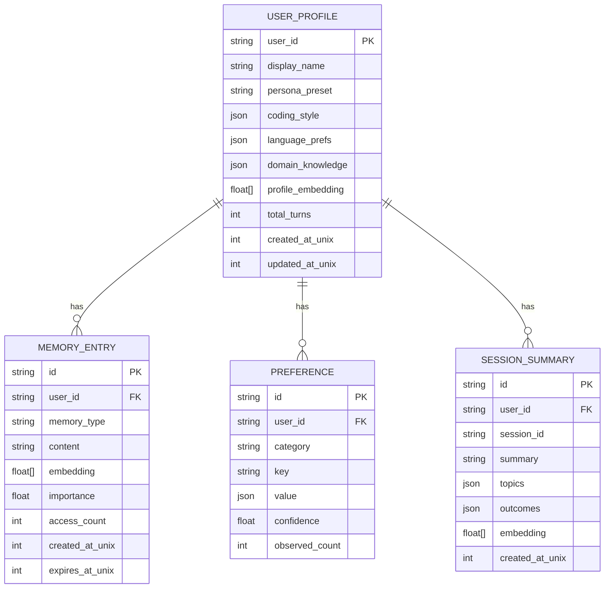
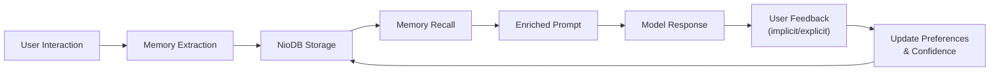

# NioXS Companion Gateway — Architecture Proposal

## Vision

Transform NioXS from a **stateless routing gateway** into a **persistent companion gateway** that learns, adapts, and truly understands each user over time — while remaining a lightweight local service.

---

## 1. Universal Directives (All Models, Not Just NioNano)

### Current State
- Directives (`--code:`, `--helm`, `--no-helm`, `--with-helm`) are parsed in [`profiles.rs`](file:///home/mn/nio-labs/nio-xs/crates/nano/src/profiles.rs) but only consumed when the request goes through NioNano's intent classifier.
- When a user sends `model: "gpt-4o"` or any non-Nio model to the gateway, directives in the prompt are ignored — the request is proxied raw.
- Profile-based routing, skill injection, and tool budgets only apply to `nio-*` models.

### Proposed Change

```
┌─────────────────────────────────────────────────────────┐
│                   NioXS Gateway                         │
│                                                         │
│  ┌─────────────┐    ┌──────────────┐    ┌────────────┐  │
│  │  Directive   │───▶│  Companion   │───▶│  Upstream   │ │
│  │  Parser      │    │  Middleware   │    │  Router     │ │
│  │ (universal)  │    │ (enrich/wrap) │    │ (any model) │ │
│  └─────────────┘    └──────────────┘    └────────────┘  │
│         ▲                   ▲                  ▲        │
│         │                   │                  │        │
│  flags, persona,     user profile,       openrouter,    │
│  skill hints        memory recall        local LLM,     │
│                                          any provider   │
└─────────────────────────────────────────────────────────┘
```

**What this means:**
- **Any model** sent through NioXS can benefit from: skill injection, persona forwarding, tool schemas, flow orchestration, and memory enrichment.
- A new **Companion Middleware** layer sits between directive parsing and upstream routing.
- Directives become **gateway-level concerns**, not model-level concerns.

### Concrete Steps
1. Move directive parsing from `nano/src/lib.rs` (inside `decide()`) to a new `gateway/src/directives.rs` module that runs **before** model routing.
2. Create a `CompanionEnvelope` struct that wraps any `ChatRequest` with parsed directives, resolved user profile, and recalled memories.
3. For Nio models → existing flow (NioNano classify + profile routing).
4. For external models → inject companion context (persona, memories, project context) as a system message prefix before forwarding upstream.

---

## 2. User Profile & Personalization (NioDB Vectors)

### Current State
- NioDB already supports:
  - **Records API**: `POST /api/v1/records` with collections, TTL, idempotency keys
  - **Vector Search**: `POST /api/v1/records/search` with cosine similarity, `embedding` field, `min_score`, `top_k`
  - **User records**: `UserRecord` with `workspace_id`, `username`
  - **Visibility**: `owner_id` field for per-user record scoping
- Currently used collections: `nano_events`, `nano_actions`, `nano_runs`, `nano_cache`, `nano_evidence`, `nano_flow`
- Local history: `.nioxs/history.jsonl` with `LocalTurnRecord` (turn_id, prompt, intent, outcome, summary)
- **No user profile**, **no preference tracking**, **no memory across sessions**.

### Proposed: User Memory Architecture



### New NioDB Collections

| Collection | Purpose | TTL |
|---|---|---|
| `companion_profiles` | User identity, coding style, preferences | Permanent |
| `companion_memories` | Factual memories extracted from conversations | 90 days |
| `companion_preferences` | Learned preferences (model, style, tools) | Permanent |
| `companion_sessions` | Session summaries for cross-session continuity | 30 days |
| `companion_feedback` | Explicit user corrections and reactions | Permanent |

### Memory Types

| Type | Example | How Learned |
|---|---|---|
| `fact` | "User works on nio-labs, a Rust-based AI CLI" | Extracted from conversation |
| `preference` | "User prefers concise responses with code examples" | Inferred from corrections |
| `skill` | "User is experienced with Rust async, TypeScript" | Inferred from questions/code |
| `project` | "Main project is nio-xs, a gateway at port 7460" | Extracted from tool usage |
| `correction` | "User corrected: use `--no-helm` not `--helm` as default" | Explicit correction |
| `pattern` | "User typically asks follow-ups after reading files" | Behavioral analysis |

---

## 3. Companion Intelligence Layer

### 3a. Memory Extraction Pipeline

After each turn completes, a lightweight extraction step runs:

```
User Turn → Model Response → [Memory Extractor] → NioDB
                                    │
                    ┌───────────────┼───────────────┐
                    ▼               ▼               ▼
              Extract Facts   Detect Prefs    Update Profile
              (entities,      (model choice,  (turn count,
               projects,       verbosity,      domains,
               tech stack)     tool usage)     last active)
```

**Implementation**: This does NOT require another LLM call. It uses:
1. **Pattern matching** on the prompt (project names, file paths, language keywords).
2. **Statistical tracking** of model selections, directive usage, tool invocation patterns.
3. **Periodic LLM summarization** (every N turns) using a cheap model to condense session context into a memory entry with an embedding.

### 3b. Memory Recall at Request Time

```
New Request → [Recall Pipeline] → Enriched System Prompt
                    │
        ┌───────────┼───────────────┐
        ▼           ▼               ▼
   Profile      Semantic         Session
   Context      Memory Search    Continuity
   (identity,   (NioDB vector    (recent session
    prefs,       similarity on    summaries,
    style)       the prompt)      ongoing tasks)
```

Before forwarding any request (Nio model or external), the companion middleware:
1. **Loads the user profile** from `companion_profiles`.
2. **Searches relevant memories** via vector similarity against the current prompt.
3. **Retrieves recent session summaries** for continuity.
4. **Injects a companion context block** into the system message:

```
[Companion Context — do not repeat this to the user]
User: mn (experienced Rust developer, prefers concise answers)
Recent context: Working on nio-xs gateway, recently added --no-helm default
Relevant memories:
- User's main projects: nio (CLI), nio-xs (gateway), nio-db (storage)
- User prefers openrouter/free as default model
- User values "thinking..." status visibility in CLI
Session continuity: Last session fixed tool budget exhaustion and pagination
```

### 3c. Embedding Strategy

> [!IMPORTANT]
> Embeddings are the key enabler for semantic memory recall.

**Options (ranked by preference):**

1. **Local lightweight embeddings** (recommended for privacy & speed):
   - Use a small model like `all-MiniLM-L6-v2` (384 dims, ~22MB) compiled to ONNX/WASM.
   - Run in-process in the gateway — zero network latency.
   - Sufficient for memory recall (not doing RAG over large corpora).

2. **Hash-based pseudo-embeddings** (zero-dependency fallback):
   - TF-IDF style feature hashing on n-grams of the prompt.
   - Lower quality but zero external dependency, fast.
   - Good enough for "is this prompt about Rust?" type recall.

3. **Upstream embedding API** (optional):
   - Call OpenRouter or another provider's embedding endpoint.
   - Better quality but adds latency and API dependency.

**Recommendation**: Start with option 2 (hash-based) for MVP, add option 1 later.

---

## 4. Adaptive Companion Behavior

### 4a. Style Adaptation

Track and adapt to user's communication style:

| Signal | Tracked Via | Adaptation |
|---|---|---|
| Response length preference | Avg words in user messages vs edits | Adjust verbosity |
| Code vs. explanation ratio | Whether user reads explanations or skips | More/less prose |
| Preferred language | File extensions in project, explicit mentions | Default language context |
| Tool usage patterns | Which tools user invokes most | Proactive suggestions |
| Time patterns | When user is active | Greeting adaptation |

### 4b. Proactive Suggestions

Based on accumulated context, the companion can:
- **Suggest relevant skills** when a prompt matches a known domain.
- **Warn about known issues** ("Last time you tried X, the issue was Y").
- **Recommend workflow changes** ("You've been using `--helm` explicitly; it's now the default").
- **Surface relevant memories** ("You worked on this file 3 sessions ago; here's what changed").

### 4c. Feedback Loop



- **Implicit feedback**: User asks a follow-up (model didn't go deep enough), user corrects output, user re-runs with different flags.
- **Explicit feedback**: A `:remember` command to store a fact, `:forget` to remove one, `:preferences` to view/edit.

---

## 5. Implementation Phases

### Phase 1: Foundation (Universal Directives + User Profile) ← Start here

**Scope:**
- [ ] New `companion` module in `nioxs_provider` with `CompanionMiddleware`
- [ ] Universal directive parsing for all models (extract directives before routing)
- [ ] Basic `companion_profiles` collection in NioDB (user_id, display_name, turn_count, coding_style)
- [ ] Profile loading at request time — inject user context into system prompt
- [ ] Profile auto-creation on first request
- [ ] Turn counter and last-active tracking

**Estimated effort:** 2-3 days

### Phase 2: Memory System (Extract + Recall)

**Scope:**
- [ ] Memory extraction pipeline (pattern-based fact extraction after each turn)
- [ ] Hash-based pseudo-embeddings for memory entries
- [ ] `companion_memories` collection with vector search recall
- [ ] Semantic memory injection into system prompt (top-5 relevant memories)
- [ ] `companion_sessions` for cross-session summaries
- [ ] `:remember "fact"` and `:forget` commands

**Estimated effort:** 3-4 days

### Phase 3: Adaptation (Learn + Suggest)

**Scope:**
- [ ] `companion_preferences` with confidence scoring
- [ ] Style adaptation (verbosity, code ratio, language)
- [ ] Proactive suggestions based on patterns
- [ ] Feedback loop (implicit correction detection)
- [ ] `:preferences` command to view/edit learned preferences

**Estimated effort:** 3-4 days

### Phase 4: Advanced (Embeddings + Intelligence)

**Scope:**
- [ ] Local ONNX embedding model (all-MiniLM-L6-v2 or similar)
- [ ] High-quality semantic memory recall
- [ ] Cross-project knowledge transfer
- [ ] Conversation topic clustering
- [ ] Long-term behavioral analysis

**Estimated effort:** 4-5 days

---

## 6. Key Design Decisions to Make

> [!WARNING]
> These decisions should be made before starting Phase 1.

| # | Question | Options | Recommendation |
|---|---|---|---|
| 1 | **User identification** | a) Derive from NioDB auth token<br>b) Explicit `--user` flag<br>c) Machine fingerprint (hostname+username) | **(c)** Machine fingerprint — zero config, works locally |
| 2 | **Memory privacy** | a) All local (NioDB only)<br>b) Optional cloud sync | **(a)** Local only — aligns with Nio's privacy-first ethos |
| 3 | **Embedding approach for MVP** | a) Hash-based pseudo-embeddings<br>b) Local ONNX model<br>c) API-based | **(a)** Hash-based for MVP; upgrade to (b) in Phase 4 |
| 4 | **Directive scope for external models** | a) Full skill injection<br>b) Context-only (persona + memory)<br>c) Opt-in per model | **(b)** Context enrichment only — skills are Nio-specific |
| 5 | **Memory extraction trigger** | a) After every turn<br>b) After significant turns only<br>c) Periodic batch | **(a)** Every turn, but lightweight pattern matching only |
| 6 | **Profile data format** | a) Flat JSON in NioDB record<br>b) Structured Rust types serialized | **(b)** Typed Rust structs → serde_json → NioDB |

---

## 7. What Makes This Unique

Most AI gateways (LiteLLM, OpenRouter, etc.) are **stateless proxies**. NioXS as a companion gateway would be unique because:

1. **Memory-aware routing** — The gateway knows your project, your style, your history.
2. **Cross-model continuity** — Switch from GPT-4 to Claude to a local model; your context and preferences follow.
3. **Zero-config personalization** — No explicit setup; the companion learns from interaction.
4. **Privacy-first** — All memory is local in NioDB; nothing leaves your machine unless you choose.
5. **Universal enrichment** — Any model benefits from the companion layer, not just Nio-native models.

---

## Ready to proceed?

If this direction looks right, I'll start with **Phase 1**: implementing the universal directive parsing and basic user profile system. Let me know which design decisions you'd like to make first, or if you want to adjust the phasing.
